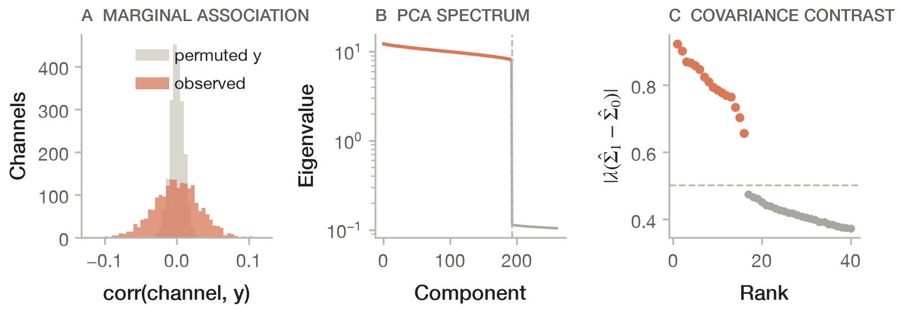
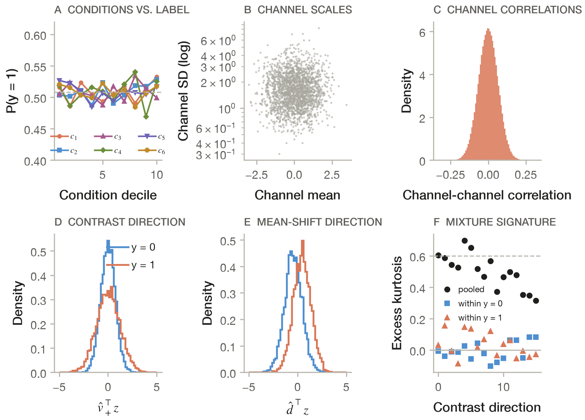
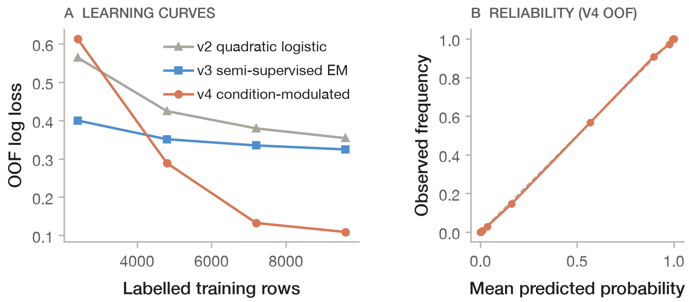
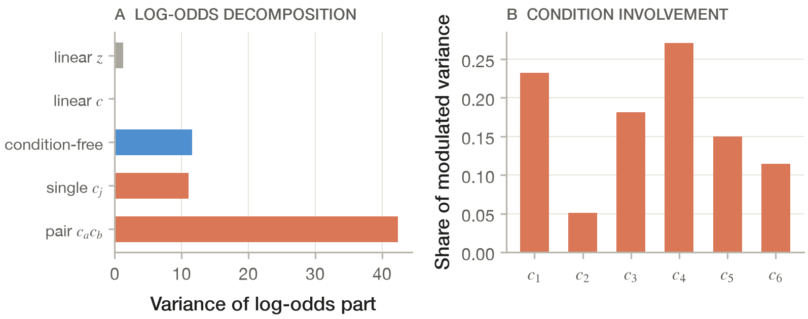
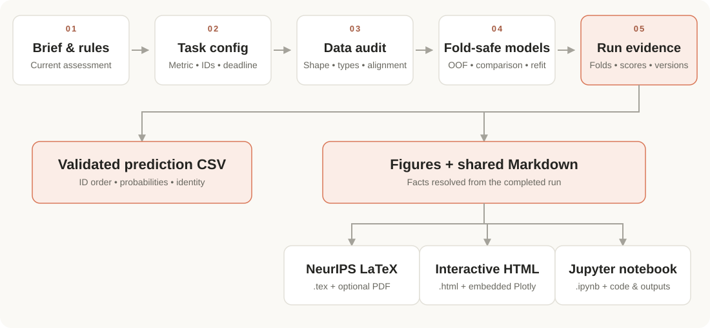

<div align="center">

# 🎓 AMA4602 Kaggle Midterm Skill

### From an exam brief to validated predictions — and a report worth reading.

🧠 **Classification & regression** · 🔬 **Statistical analysis** · 🎨 **Scientific figures**

📄 **LaTeX / NeurIPS** · 🌐 **Interactive HTML** · 📓 **Jupyter with code & outputs**

[🚀 Get started](#quick-start) · [🧰 Features](#features) · [📚 Exam archive](#exam-archive) · [🖼️ Gallery](#gallery) · [🏗️ How it works](#how-it-works)

</div>



<p align="center"><em>A glimpse of the 2026 case study: weak marginal signals, a clear latent spectrum, and hidden covariance structure.</em></p>

This repository turns lessons from winning Kaggle tabular notebooks and real AMA4602 assessments into a reusable agent workflow. Give your agent the current brief, data and time budget; it can audit the inputs, compare models with fold-safe validation, prepare an identity-correct prediction file, and explain the results through figures and reports.

The repository also preserves **two teaching datasets with their own English task guides**: the **2025 Gene/PANCAN exercise** and the **2026 Smart Coatings challenge**. The current assessment's rules always define what you may use and what you must submit.

<a id="contents"></a>
## 🧭 Explore the repository

| Start here | Go deeper |
|---|---|
| [🚀 Quick start](#quick-start) — install and rehearse | [🏆 How this skill was built](#how-it-was-built) — winning notebooks to reusable practice |
| [🧰 Supported features](#features) — what to ask your agent | [🏗️ How the workflow works](#how-it-works) — instructions, scripts and evidence |
| [📚 Historical exam archive](#exam-archive) — data, questions and configs | [🖼️ Report gallery](#gallery) — figures from the final 2026 report |
| [📄 Three report modes](#report-modes) — LaTeX, HTML and Jupyter | [🛠️ Command cookbook](#cookbook) — run the individual tools |
| [📁 Repository map](#repository-map) — where things live | [✅ Checks and packaging](#checks) — validate and share the skill |

<a id="features"></a>
## 🧰 What can the skill do?

| Capability | What you get | Example request to your agent |
|---|---|---|
| 📋 **Read the task** | A task contract covering target, metric, schema, identity, rules and deadline | “Read this year's brief and sample submission. Establish the task before fitting anything.” |
| 🔎 **Audit the data** | Shape, missingness, constants, class balance, ID joins and alignment alerts | “Profile these wide tables and check whether the external labels match the specimen IDs.” |
| 🧠 **Model tabular data** | Classification and regression; numeric and mixed categorical tables; linear models, SVMs, forests and boosting | “Compare a regularized linear model and a tree model under the official metric.” |
| 🛡️ **Validate without leakage** | Frozen stratified, grouped or temporal folds; fold-local preprocessing; OOF predictions and run evidence | “Fit imputation, feature selection and PCA inside each fold. Explain which scores were used for selection.” |
| 🏁 **Search within a budget** | Repeated-CV comparisons, optional shift checks, supported blending and final refitting | “Use five minutes to improve the baseline, keeping enough time to refit and validate the CSV.” |
| 🔬 **Investigate structure** | Exploratory association tests with BH correction, label-free PCA, clustering and agreement summaries | “Separate exploratory association analysis from predictive validation, then compare clusters with the known classes.” |
| 🎨 **Make scientific figures** | Model comparisons, confusion matrices, importance, PCA/clustering and association plots; PDF + PNG exports | “Build figures from the finished run and write captions that state the evidence and limitations.” |
| 📄 **Write reports** | A shared Markdown source producing NeurIPS-style LaTeX, interactive HTML and executed Jupyter notebooks | “Turn this completed run into a paper, an interactive report and a notebook with code and outputs.” |
| 📮 **Prepare the final CSV** | ID-based alignment, probability checks, exact columns, official filename and a local validation receipt | “Assemble the prediction file in sample-submission order using my current identity.” |

The bundled scripts support reusable baselines and standard reporting. Task-specific ideas can be added when the evidence warrants them; the custom covariance models in the [2026 case study](references/smart-coatings-2026.md) are examples of that extension work. Runtime budgets are checked between fits, so leave a buffer for a fit that is already running.

<a id="quick-start"></a>
## 🚀 Quick start

### 1️⃣ Download and prepare one Python environment

```sh
git clone https://github.com/DumanHaoqian/AMA4602-Kaggle-Midterm.git
cd AMA4602-Kaggle-Midterm
python3 -m venv .venv
.venv/bin/python -m pip install -r requirements.txt
```

**One requirements file covers all Python functionality**, including modelling, boosting, figures, reports and release checks. Use Python **3.10+**. On Windows, use `.venv\Scripts\python.exe` in place of `.venv/bin/python`. Some macOS boosting installations also need an OpenMP runtime.

The full Git clone includes the archived datasets. For the skill without those datasets, use the lightweight ZIP produced by `scripts/build_release.py` or attached by the maintainer to a GitHub Release. The repository root and the extracted ZIP both contain the `SKILL.md` entry point.

### 2️⃣ Install into your agent

```sh
# Codex
.venv/bin/python -B scripts/install_skill.py --client codex

# Or Claude Code
.venv/bin/python -B scripts/install_skill.py --client claude
```

| Installation | Destination |
|---|---|
| Codex | `~/.agents/skills/ama4602-kaggle-exam` |
| Earlier Codex installations: `--client codex-legacy` | `$CODEX_HOME/skills/ama4602-kaggle-exam`, defaulting to `~/.codex/skills/ama4602-kaggle-exam` |
| Claude Code | `~/.claude/skills/ama4602-kaggle-exam` |
| Custom or project-local: `--dest /absolute/path/ama4602-kaggle-exam` | The exact destination you supply |

The installer refuses an existing destination and copies the skill without the dataset archive. It does not install Python packages or change client configuration. Open a new client session if the skill is not detected. See the [official Codex skill documentation](https://developers.openai.com/codex/skills) for discovery locations; other clients must support local `SKILL.md` files and Python execution.

### 3️⃣ Ask your agent to use it

```text
$ama4602-kaggle-exam
Read my current brief, config and data. Confirm the official metric, rules,
identity and remaining time. Build a leakage-safe baseline, validate the final
prediction CSV, and produce the reports the assignment actually requires.
Use the Python interpreter in this repository's .venv.
```

In Claude Code, invoke `/ama4602-kaggle-exam` or point the agent to the installed `SKILL.md`.

### 4️⃣ Rehearse with synthetic data first

```sh
.venv/bin/python -B scripts/create_demo.py --output-dir demo
.venv/bin/python -B scripts/profile_data.py --config demo/config.json
.venv/bin/python -B scripts/evaluate_models.py \
  --config demo/config.json --models select_logistic --budget-seconds 60
```

Replace `RUN_DIR` below with the completed run path printed by the model script:

```sh
.venv/bin/python -B scripts/validate_submission.py \
  --config demo/config.json \
  --predictions RUN_DIR/test_predictions.csv \
  --evidence RUN_DIR/evidence.json --output-dir demo/final/v1
```

The demo produces `DEMO0000_Demo_Student.csv` and a local receipt using fictional identity. Keep demo files for rehearsal. New-data generation and submission export refuse existing targets, so use a fresh directory for another attempt.

[⬆️ Back to the index](#contents)

<a id="exam-archive"></a>
## 📚 Learn from the exam archive

| Archive | What the data describe | What students were asked to do | Data and task guide | Skill config |
|---|---|---|---|---|
| 🧬 **2025 · Gene / PANCAN** | 801 labelled specimens, 20,531 anonymous gene features and an Edema variable | Study associations, explore clusters, reduce dimensionality, compare tumour classifiers, and explain reproducible results | [Dataset + task](https://github.com/DumanHaoqian/AMA4602-Kaggle-Midterm/tree/main/datasets/2025-pancan) | [PANCAN config](assets/pancan_config.example.json) |
| 🧪 **2026 · Smart Coatings** | 12,000 training and 6,000 test specimens; six process conditions and 2,042 scan channels | Predict qualification probabilities, scored by binary log loss; export exactly `id,target` | [Dataset + task](https://github.com/DumanHaoqian/AMA4602-Kaggle-Midterm/tree/main/datasets/2026-smart-coatings) | [2026 config](assets/smart_coatings_2026_config.example.json) |

🔗 **Original competition:** [AMA4602 Smart Coatings Statistical Challenge on Kaggle](https://www.kaggle.com/competitions/ama-4602-smart-coatings-statistical-challenge/overview).

Each dataset folder has an English README with context, file meanings, task requirements and loading instructions. PANCAN's large feature table is distributed as a lossless `.csv.gz` file; its page shows how to decompress it. The original Smart Coatings NPZ archives are included directly. Student notebooks, personal submission files and identity configurations are excluded from the archive.

### 🧪 Run the 2026 example

The model scripts read CSV/TSV. Prepare the original NPZ files once, without fitting any transformations:

```sh
.venv/bin/python -B scripts/prepare_smart_coatings.py \
  --train datasets/2026-smart-coatings/train.npz \
  --test datasets/2026-smart-coatings/test.npz \
  --sample-submission datasets/2026-smart-coatings/sample_submission.csv \
  --output-dir workspaces/coatings-2026

.venv/bin/python -B scripts/profile_data.py \
  --config workspaces/coatings-2026/config.json
.venv/bin/python -B scripts/evaluate_models.py \
  --config workspaces/coatings-2026/config.json \
  --models select_logistic,pca_logistic --budget-seconds 300
```

The converter preserves the specimen IDs, feature order and sample-submission file. Its generated config leaves your identity blank and the deadline unset. The sample baseline is a starting point; it does not reproduce the report's custom final model. Read the [full 2026 case study](references/smart-coatings-2026.md) or the [PANCAN analysis notes](references/pancan-reference.md) for the reasoning behind each task.

<a id="gallery"></a>
## 🖼️ From data to an explanation: the 2026 report gallery

These original English figures come from Haoqian Du's final 2026 report, *Hidden Contrasts: Condition-Modulated Quadratic Discrimination for Smart-Coating Qualification*. They show a completed, task-specific analysis built around the workflow. The latent covariance methods, custom learning curves and model decomposition are extensions beyond the bundled generic plotting commands.

### 🔎 1. Explore what simple screening misses



**Read the measurements before choosing a model.** Condition-decile profiles, channel scales and class-conditional distributions expose structure that a marginal correlation screen can miss. These are exploratory training-data summaries. The latent spectrum and covariance contrasts are shown in the opening figure.

### 📈 2. Evaluate learning and calibration



**Check both data efficiency and probability quality.** Learning curves compare three custom models; the reliability plot compares out-of-fold predicted probabilities with observed frequencies. The reported curves use fold-internal fits under the archived validation design.

### 🧩 3. Explain where the evidence comes from



**Turn the fitted model into an interpretable story.** The decomposition describes which term groups contribute to the fitted log-odds and how conditions participate in modulated terms. These are in-sample descriptions, not causal effects.

<details>
<summary>🏁 Historical results behind the figures</summary>

The final report records the following log-loss progression; lower is better. These are **selection-CV** values and **reported public leaderboard** values, not private-test results or a promised score for the shared scripts.

| Model in the archived report | Selection-CV log loss | Reported public log loss |
|---|---:|---:|
| Raw L2 logistic baseline | 0.6061 | 0.6289 |
| Latent quadratic logistic | 0.3565 | 0.3323 |
| Semi-supervised structured Gaussian EM | 0.3252 | 0.3098 |
| Condition-modulated quadratic logistic | **0.1081** | **0.0813** |

Model structure and hyperparameters were selected using CV, so the selected model's CV estimate is optimistic. The report does not establish a private score or final rank. See the [case study](references/smart-coatings-2026.md) for methods and limitations.

</details>

[⬆️ Back to the index](#contents)

<a id="report-modes"></a>
## 📄 One analysis, three report experiences

| 📄 LaTeX / NeurIPS-style paper | 🌐 Interactive HTML report | 📓 Jupyter notebook with code |
|---|---|---|
| A `.tex` manuscript using the bundled NeurIPS style, with tables, vector figures, captions and references. Optional compilation produces a PDF. | A single HTML file with embedded Plotly charts, hover details, zoom controls, a contents sidebar and collapsible code blocks. | An `.ipynb` combining explanations, executable code, tables, figures and the outputs of the executed cells. |
| Best for a written hand-in or paper-style presentation. | Best for exploring and sharing the analysis in a browser. | Best for teaching, inspection and reproducing the analysis steps. |

The standard report builder reads **one Markdown source and completed run evidence**. Numbers are resolved from `{{fact}}` placeholders, so the three formats describe the same run. For example:

```text
The selected model reaches a selection-CV {{metric}} of {{selected_score}}
across {{cv_design}} splits, against a baseline of {{baseline_score}}.
```

Copy a report template into your own workspace, set the current author/config/run paths, replace every `REPLACE_` marker, and rewrite the prose for the actual task:

```sh
mkdir -p workspaces/my-exam/reports
cp assets/report_minimal.md workspaces/my-exam/reports/report.md

# Inspect the available evidence-backed facts:
.venv/bin/python -B scripts/build_reports.py \
  --source workspaces/my-exam/reports/report.md --list-facts

# Build all three formats after editing the source:
.venv/bin/python -B scripts/build_reports.py \
  --source workspaces/my-exam/reports/report.md \
  --formats tex,html,ipynb --no-compile
```

```text
reports/
├── report.md                 ✍️ Shared source
├── tex/report.tex            📄 NeurIPS-style LaTeX
├── tex/report_figures/       🎨 Vector figures
├── html/report.html          🌐 Interactive report
└── jupyter/report.ipynb      📓 Executed code + outputs
```

For **PDF output**, install [Tectonic](https://tectonic-typesetting.github.io/) and remove `--no-compile`; its first run may download LaTeX packages. Check the build status before claiming a PDF exists. Notebook execution uses the current Python interpreter. HTML chart interactions work offline because Plotly is embedded; KaTeX mathematics and Google Fonts use network CDNs. Report details and source syntax are documented in [reporting.md](references/reporting.md).

<a id="how-it-was-built"></a>
## 🏆 How this skill was built

We developed the workflow by **reviewing and summarizing winning notebooks from multiple Kaggle tabular competitions**, then adapting recurring ideas to AMA4602's time limits and deliverables. The aim is to make the useful decisions repeatable: read the metric carefully, validate the right way, establish a baseline early, test complementary models, and carry the evidence through to the final submission and explanation.

| Stage | What we distilled |
|---|---|
| 🏆 **Study winning tabular solutions** | Validation design, preprocessing choices, model diversity, categorical handling, ensembling and submission discipline |
| 🧩 **Extract reusable patterns** | Retain broadly useful techniques; make competition-specific tricks conditional on the current data and rules |
| 🛠️ **Turn patterns into tools** | Config-driven scripts for data checks, fold-safe models, saved evidence, figures and reporting |
| ⏱️ **Adapt for an assessment** | Early valid predictions, bounded searches, a final-fit buffer and exact identity/schema requirements |
| 🧪 **Check the implementation** | Synthetic end-to-end rehearsal, independent fold-only prediction checks, ID alignment and report execution |
| 📚 **Learn from real cases** | Archive the PANCAN and Smart Coatings tasks, and document where task-specific modelling changed the outcome |

The skill also draws on the documented validation, statistical-analysis, visualisation and writing resources in [sources.md](references/sources.md). The bundled Python workflow is an original implementation, with separate attribution for the NeurIPS templates. Real exam findings and notebook techniques guide model choices; the current brief and local validation decide whether they apply.

<a id="how-it-works"></a>
## 🏗️ How the workflow works



| Layer | What it contributes |
|---|---|
| 🧭 `SKILL.md` | The agent's decision process: establish the task, manage time, choose validation, then deliver the required outputs |
| 📚 `references/` | Detailed guidance loaded when needed: metrics, modelling, statistics, Kaggle operations, writing and historical cases |
| ⚙️ `config.json` | The task-specific inputs: paths, target, IDs, metric, prediction semantics, folds, budget and identity |
| 🛠️ `scripts/` | Repeatable execution for loading, auditing, modelling, plotting, report building and CSV validation |
| 🧾 Run artifacts | Saved folds, parameters, OOF predictions, scores, actual package versions, warnings and final predictions |
| 🎨 Reporting layer | Figures and a shared source whose facts resolve from the completed run |

All config paths resolve relative to the **config file's directory**. Imputation, scaling, supervised selection and PCA used in predictive validation are fitted within training folds. Exploratory all-training-data analysis is described separately. Keep the real metric and prediction semantics: a probability task needs probabilities, not thresholded labels.

<a id="cookbook"></a>
## 🛠️ Command cookbook

Run from the repository with the verified interpreter. Replace `CONFIG`, `RUN_DIR` and `STRUCTURE_DIR` with your own paths. Standard scripts write outputs into the configured workspace.

| Goal | Command |
|---|---|
| 🔎 Inspect data | `.venv/bin/python -B scripts/profile_data.py --config CONFIG` |
| 🧠 Numeric classification baseline | `.venv/bin/python -B scripts/evaluate_models.py --config CONFIG --models select_logistic,pca_logistic --budget-seconds 300` |
| 📉 Numeric regression baseline | `.venv/bin/python -B scripts/evaluate_models.py --config CONFIG --models ridge,pca_ridge --budget-seconds 300` |
| 🌳 Mixed-table classification | `.venv/bin/python -B scripts/leaderboard.py --config CONFIG --families logreg_l2,lightgbm --max-trials 1 --budget-seconds 90` |
| 🔬 Associations and clustering | `.venv/bin/python -B scripts/analyze_structure.py --config CONFIG --mode both` |
| 🎨 Plot a completed run | `.venv/bin/python -B scripts/plot_results.py --run RUN_DIR --structure STRUCTURE_DIR --no-titles` |
| 📮 Assemble a valid CSV | `.venv/bin/python -B scripts/validate_submission.py --config CONFIG --predictions RUN_DIR/test_predictions.csv --evidence RUN_DIR/evidence.json --output-dir final/v1` |

Use `assets/exam_config.example.json` for a new task. Set the actual task, target, ID keys, official metric, sample schema, prediction kind and identity. For regression, use an appropriate regression metric, `prediction.kind=regression` and a suitable split. For probabilities, set the positive class and class-column order explicitly. Grouped or temporal data need a matching validation design.

Kaggle download/upload uses a separately installed official CLI and your own authentication. Upload only when authorized by the current user and permitted by the assessment. A local receipt means **locally validated**; platform acceptance, scoring status and scores must be checked on Kaggle. Keep credentials and personal working configs outside the shared archive.

[⬆️ Back to the index](#contents)

<a id="repository-map"></a>
## 📁 Repository map

```text
AMA4602-Kaggle-Midterm/
├── SKILL.md                         🧭 Agent instructions
├── README.md                        📖 This guide
├── requirements.txt                 📦 All Python dependencies
├── agents/                          🪪 Client display metadata
├── scripts/                         🛠️ Runnable tools
├── references/                      📚 Methods and case studies
├── assets/
│   ├── *.example.json               ⚙️ General + historical configs
│   ├── report_*.md                  ✍️ Report source templates
│   ├── neurips_2026/                📄 Paper formatting assets
│   └── showcase/                    🖼️ Figures from the final 2026 report
├── datasets/
│   ├── 2025-pancan/                 🧬 Compressed table, labels and task README
│   └── 2026-smart-coatings/          🧪 Original NPZ files, sample CSV and task README
└── .github/workflows/               ✅ Automated checks and packaging
```

The **skill ZIP and installed skill exclude `datasets/`**. The complete GitHub repository includes the two data archives so students can read the task guides and rehearse locally. Historical data materials retain their original provenance; the project's MIT license applies to the original code and documentation, as explained in [THIRD_PARTY_NOTICES.md](THIRD_PARTY_NOTICES.md).

<a id="checks"></a>
## ✅ Checks and packaging

```sh
.venv/bin/python -B scripts/check_release.py
.venv/bin/python -B scripts/smoke_test.py --reports
.venv/bin/python -B scripts/build_release.py
```

Checks cover skill metadata, local links, installation protection, release contents, and synthetic classification/regression/mixed-table workflows. The report rehearsal executes the notebook and builds HTML and LaTeX source; it skips PDF compilation. Local execution has been checked on macOS / Python 3.13; Linux / Python 3.10 and 3.13 are configured in CI, and Windows has not been exercised.

The default package is `dist/ama4602-kaggle-exam.zip`. Add `--version 0.1.0` for a versioned filename. Tag-triggered CI passes the tag name to the builder and uploads a build artifact; creating a public GitHub Release is a separate maintainer action. Packaging uses an explicit source inventory and excludes datasets, credentials, environments and working outputs.

---

<p align="center">🎓 Built for learning, careful validation and clear explanations.<br>Original code: <a href="LICENSE">MIT</a> · <a href="THIRD_PARTY_NOTICES.md">Third-party notices</a> · <a href="#contents">Back to the index ↑</a><br>Community study material; no official affiliation with PolyU, Kaggle or NeurIPS.</p>
